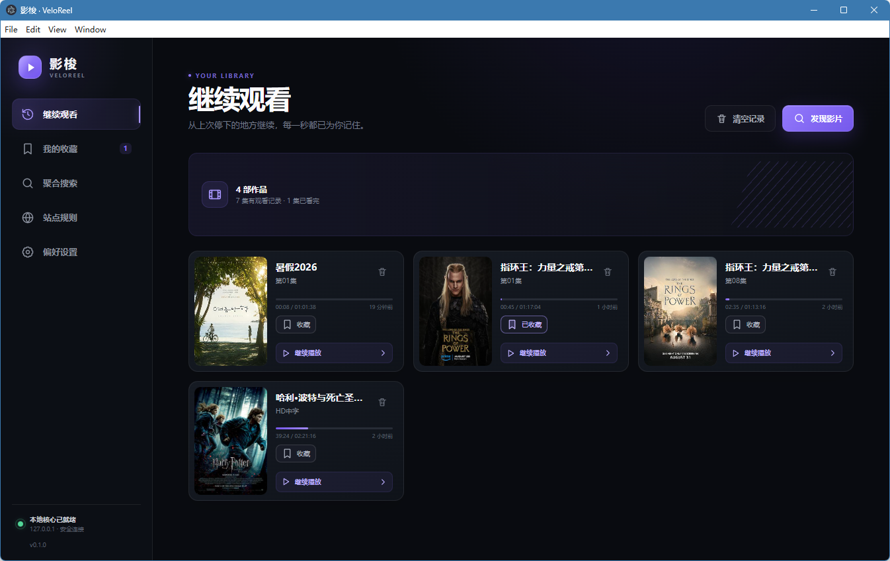
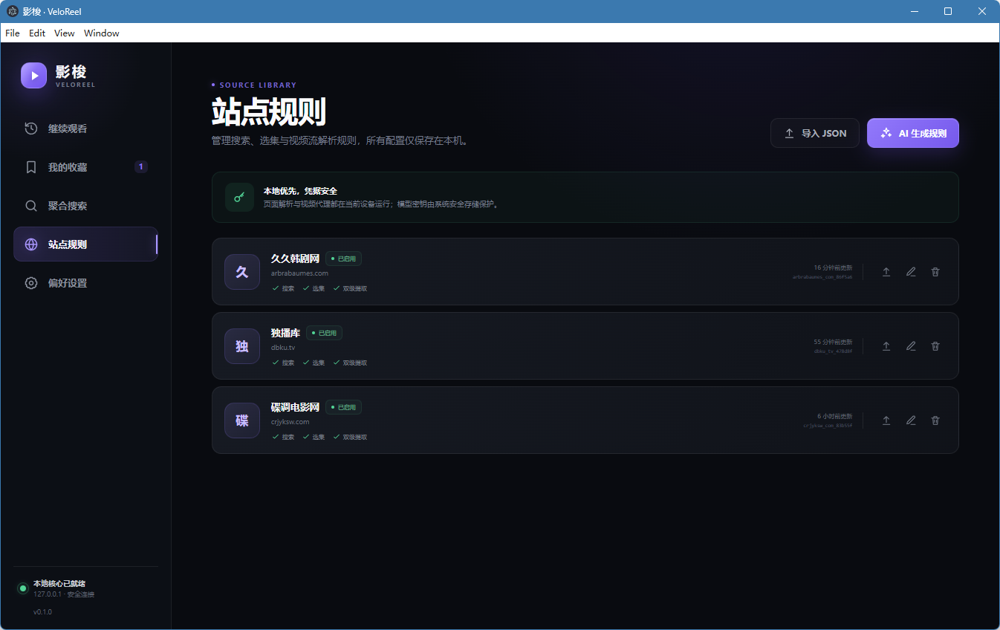
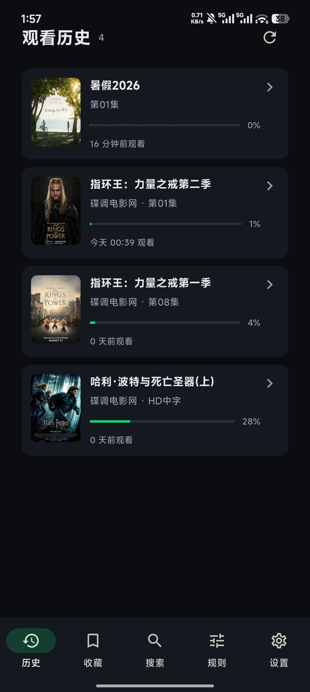

# 影梭 · VeloReel

聚合片源，流畅观影。

基于 Electron、Vue 3 与 TypeScript 的本地视频播放器。它通过可编辑的站点规则完成搜索和选集，使用静态解析与 Electron 原生网络嗅探解析无 DRM 的 HLS/MP4 流，并通过仅监听本机的代理提供防盗链请求头、HLS 清单重写、分片缓存和并发预取。

配套 Android 客户端（Flutter，见 `mobile/`）可通过局域网连接桌面端，在手机上完成搜索、选集、播放、收藏同步、断点续播和 DLNA 投屏，无需在电视上安装应用。

> 请仅连接你有权访问的内容，并遵守内容提供方的服务条款与当地法律。本项目不绕过 DRM、付费墙或访问控制。

## 截图

| 桌面端 · 继续观看 | 桌面端 · 站点规则 |
| --- | --- |
|  |  |

| 手机端 · 观看历史 |
| --- |
|  |

## 开发

```bash
npm install
npm run dev
```

首次打开后：

1. 在“偏好设置”填写 OpenAI 或兼容接口的地址、模型和 API Key。密钥通过 Electron `safeStorage` 加密，不写入普通配置文件。
2. 在“站点规则”中填写首页并点击“自动探索并生成规则”。AI 会选择网页上实际存在的搜索表单和站内链接，由主进程依次访问搜索、详情和播放页面，再依据真实页面整理完整规则。界面持续显示当前阶段和访问地址；最多执行 8 次探索，访问失败时可选择其他候选链接。保存前验证搜索结果、播放线路、选集以及静态流提取或 Electron 动态嗅探；验证失败会让模型修正一次，仍失败则不保存。通常无需填写其他地址，高级选项可手动指定样本；自动探索不足时会明确提示缺少哪类页面。也可以直接导入并编辑 JSON。

   两类特殊站点有专门处理：搜索接口带 JS Cookie 质询的站点（返回“请稍候”验证页）会自动提取 Cookie 并重试，搜索页、详情页与播放页本身照常解析；纯前端渲染（SPA）站点首页没有可解析链接，生成器会抓取页面引用的 JS bundle 静态分析，产出 **API 声明式规则**——JSON 格式的接口地址模板、请求方法与 JSONPath 字段映射，不含可执行代码，生成后通过“搜索 → 详情 → 可选流地址”的真实接口调用验证后才保存。规则页中此类站点标记为“接口搜索 / 接口选集 / 接口取流”。
3. 在“聚合搜索”选择影片和剧集。播放器会优先进行静态解析，失败后自动启用隔离的隐藏窗口嗅探。
4. 播放进度每 5 秒以及暂停、拖动、切集和关闭时保存；“继续观看”可恢复到上次位置。

同一站点、同一集的真实视频地址会独立缓存，最多保存 100 项、保留 24 小时，不随播放器关闭而删除。重开视频时先用短请求确认地址仍可用：HLS 检查清单，MP4 只请求首字节；通过后显示“缓存直连”，无需重新嗅探。地址过期、检查失败或提取规则变更时自动重新解析；缓存地址播放时发生网络错误也会自动更新一次，并保留当前进度。错误页的“重新解析”始终跳过地址缓存。

地址和防盗链请求头通过系统安全存储加密后保存，重启应用仍可复用；系统加密不可用时只在内存中保留。视频分片缓存仍属于当前播放代理会话，关闭播放器时释放。

## 播放操作

侧栏“我的收藏”保存想看的影片，支持按片名或站点筛选、查看最新选集和取消收藏。搜索结果、影片详情、观看记录及播放器顶部均可一键收藏；同一站点的同一详情页自动去重，不同站点的同名影片独立保存。收藏保存在本机，重启应用后仍可查看，清空观看记录不会删除收藏。

播放器使用 Artplayer，支持进度拖动、缓冲进度、音量、0.5–2 倍速、画面比例、画中画和全屏。切集保留当前音量和倍速，全屏内也可选集或切换上一集、下一集。播放时控制栏会自动隐藏，移动鼠标即可显示，底部保留细进度条。

点击画面后可使用快捷键；双击画面切换全屏。控制栏“快捷键”可随时查看说明。

| 按键 | 操作 |
| --- | --- |
| 空格 | 播放 / 暂停 |
| ← / → | 后退 / 前进 5 秒 |
| ↑ / ↓ | 增加 / 减少音量 5% |
| F | 切换全屏 |
| M | 静音 / 恢复音量 |
| [ / ] | 降低 / 提高倍速 |
| Esc | 关闭面板或退出全屏 |

## 模型接口配置

“偏好设置 → 规则生成模型”可选择两种接口：

- Chat Completions：向基础地址下的 `/chat/completions` 发送请求，兼容旧配置。
- Responses：向基础地址下的 `/responses` 发送请求。Codex 配置中的 `wire_api = "responses"` 对应此选项。

API Base URL 填写基础地址，例如 `https://api.openai.com/v1`，不用拼接以上路径。模型名称按服务商提供的标识填写，例如 `gpt-5.5`；API Key 对应 `experimental_bearer_token`，程序会生成 `Authorization: Bearer ...`。

如果服务商要求 `http_headers`，在“自定义请求头”中填写 JSON，例如：

```json
{
  "x-openai-actor-authorization": "local-image-extension"
}
```

两种接口默认均发送 `store: false`，对应不保存模型响应的请求选项。协议、请求头和保存选项同时用于规则生成与嗅探后的规则修复。单次生成窗口还可单独选择接口类型；留空时使用偏好设置。旧设置会默认使用 Chat Completions，不会重置已有地址、模型或密钥。

填写后可点击“测试连接”：程序使用当前尚未保存的地址、接口类型、模型、请求头和保存选项发起一次简短的 JSON 生成请求，验证模型是否实际可用。新密钥留空时使用本机已保存的密钥。测试最长 45 秒，不自动重试，可能产生少量 API 费用；不会保存或覆盖配置，确认后仍需点击“保存更改”。结果会持续显示耗时、请求地址、HTTP 状态及完整错误，并支持复制；修改配置后会标记旧结果需要重新测试。

如果返回 `429 All available accounts are currently rate-limited`，表示服务商报告其所有可用账号当前均被限流。可稍后重试，或联系服务商确认账号池、配额与恢复情况；更换接口协议本身不能解除服务商限流。测试结果会展示服务商提供的请求 ID 和 `Retry-After`（如果有），方便排查。

接口格式参考 OpenAI 官方文档：[Responses](https://developers.openai.com/api/reference/resources/responses/methods/create) / [Chat Completions](https://developers.openai.com/api/reference/resources/chat/subresources/completions/methods/create)。

## 局域网共享与手机客户端

在“偏好设置”开启“局域网共享”后，桌面端作为主进程在 `8790` 端口提供 HTTP API，并通过 UDP `39393` 广播自身，同网段的 Android 客户端自动发现、一键连接。服务仅接受私网来源请求，无配对码、无账号。

手机端能力：

- 搜索、详情、选集播放（视频流经桌面端代理解析与转发）
- 收藏增删、观看记录与断点续播（每 15 秒及退出时上报进度，与桌面端同步）
- 站点规则的查看与 JSON 编辑
- 播放手势：左右滑调进度、左侧上下滑调亮度、右侧上下滑调音量、长按 2 倍速；播放期间保持常亮
- DLNA 投屏：发现同网段电视后推送播放地址，电视自行拉流；投屏中手机变为遥控器，可查看进度、拖动定位、暂停/继续/停止，进度回写观看历史

详细协议与安全设计见 [docs/lan-sharing.md](docs/lan-sharing.md)。手机客户端构建：

```bash
cd mobile
flutter build apk --release
```

## 质量检查

```bash
npm run typecheck
npm test
npm run test:fullscreen
npm run test:security
npm run build
```

`npm run test:fullscreen` 在隐藏 Electron 窗口中验证真实全屏权限、全屏按钮、F / Esc 快捷键和全屏内选集，不生成安装包。

`npm run test:security` 在隐藏 Electron 窗口中检查第三方页面隔离、弹窗/下载拦截及本机服务访问阻止。`node tests/electron/runSecurity.mjs --public` 另外联网检查公网 HTTPS 页面能够通过安全代理正常加载。

Windows 安装包与便携版：

```bash
npm run build:win
```

输出分别位于 `out/`（生产 bundle）和 `dist/`（安装包）。

## 架构

```text
Vue renderer
  └─ typed contextBridge IPC
      ├─ 规则生成 / 搜索 / 详情解析
      ├─ 静态提取 → 隐藏 BrowserWindow 嗅探
      ├─ 127.0.0.1 随机端口 HLS/MP4 代理
      ├─ electron-store 历史、设置与安全凭据
      └─ LAN 服务（HTTP API + UDP 发现 + DLNA 投屏）─ Flutter 手机客户端
```

本地代理只接受主进程登记过的随机会话与资源令牌，不提供任意 URL 转发；远程请求会拦截本机、内网和非 HTTP(S) 地址。HLS 缓存按总字节数做 LRU 淘汰，相同分片通过 Singleflight 共用下载任务。

## 第三方站点防护

第三方播放页需要执行脚本时，会在独立、临时的沙箱窗口中运行。窗口没有 Node.js、应用 IPC 或主界面的预加载脚本，拒绝弹窗、下载、摄像头、麦克风、位置及设备权限；解析结束后销毁窗口并清理临时存储。主界面仍可使用全屏播放。

网页嗅探、页面抓取、封面与媒体请求均限制为公网 HTTP(S)。实际建立连接时校验 DNS 结果，拦截本机、内网、云元数据及保留地址；逐跳检查重定向，防止域名重新解析后绕过检查。嗅探窗口使用专属转发代理，HTTPS 隧道保留站点证书的正常验证；WebRTC 禁止绕过代理发送 UDP。主界面只加载应用资源、受控封面和本机媒体代理。

播放器继续使用本机代理进行 HLS 清单重写、分片缓存、并发预取和 MP4 Range 拖动，并保留防盗链 Referer / User-Agent。跨来源跳转与跨 CDN 资源会去掉 Cookie、Authorization 等敏感请求头。代理校验 Host、浏览器来源和随机资源令牌，拒绝网页、脚本或可执行响应作为媒体；封面只接受有正确文件头的 PNG、JPEG、GIF、WebP 和 AVIF。请求数量、并发、响应体积、清单嵌套及正则执行时间均有限制。

这些防护降低了恶意网页、下载和内网探测的风险，但无法保证未知视频与浏览器解码器绝对安全。应持续更新 Electron 与依赖；本次 Electron 已升级至 45.2.1。依赖的公开漏洞可通过 `npm audit --omit=dev --registry=https://registry.npmjs.org` 检查。

## 当前支持范围

- 普通 HTML 页面、CSS 选择器规则、相对链接
- 纯前端渲染（SPA）站点的 API 声明式规则（JSON 接口模板 + JSONPath，无可执行代码）
- 搜索接口的 JS Cookie 质询自动通过
- 无 DRM 的 HLS VOD（含 master/variant、AES key、fMP4 map）
- MP4 Range 请求与拖动
- 静态流解析与隐藏窗口嗅探兜底
- 本地历史、断点续播和自动下一集
- 局域网手机客户端（搜索/播放/收藏同步/规则编辑）与 DLNA 投屏遥控
- OpenAI 兼容接口生成站点规则，并允许人工校对

不承诺支持 Widevine/EME、验证码或 Cloudflare 挑战、只在 Blob/MSE 中出现的深度混淆流、直播时移，以及复杂的外置多音轨 HLS。
